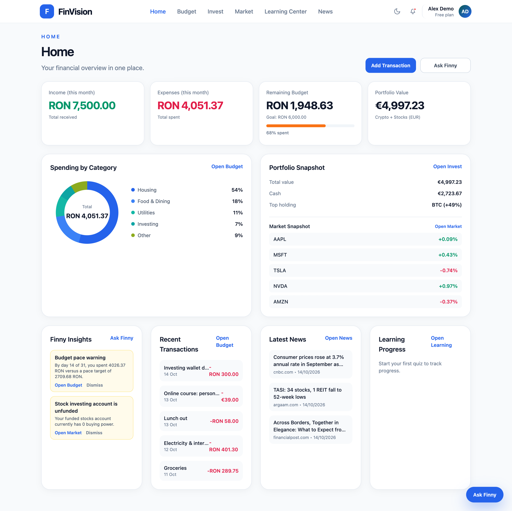
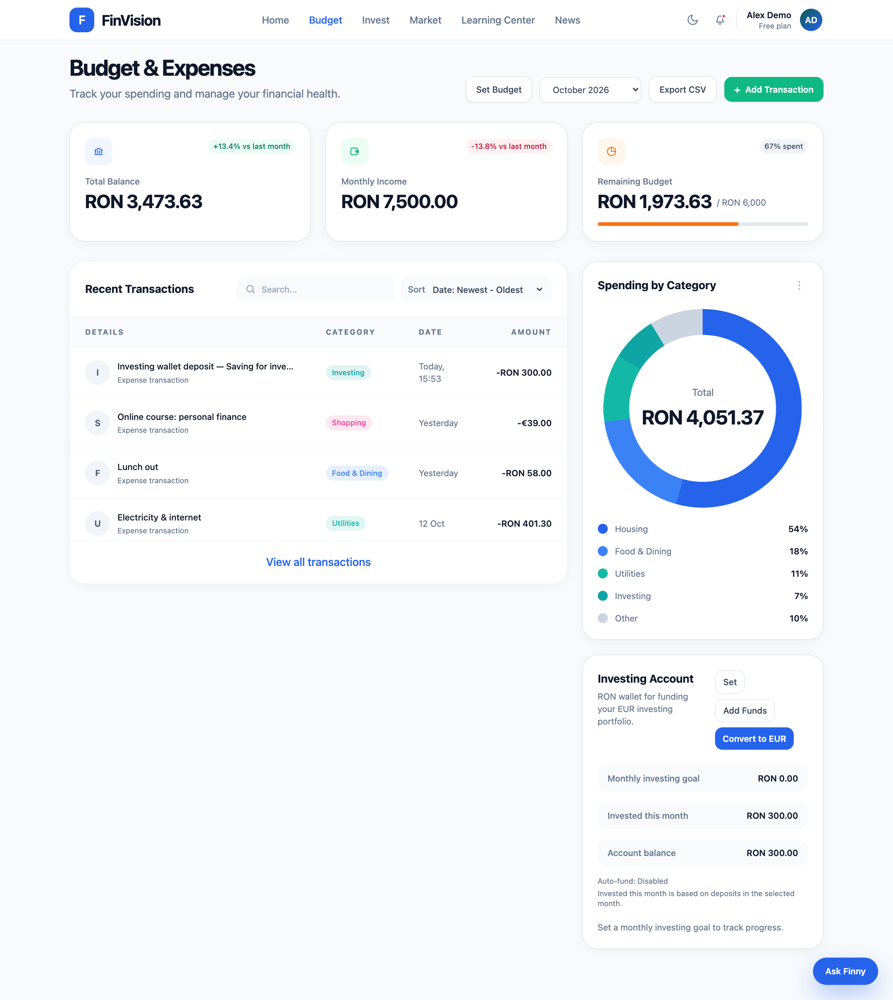
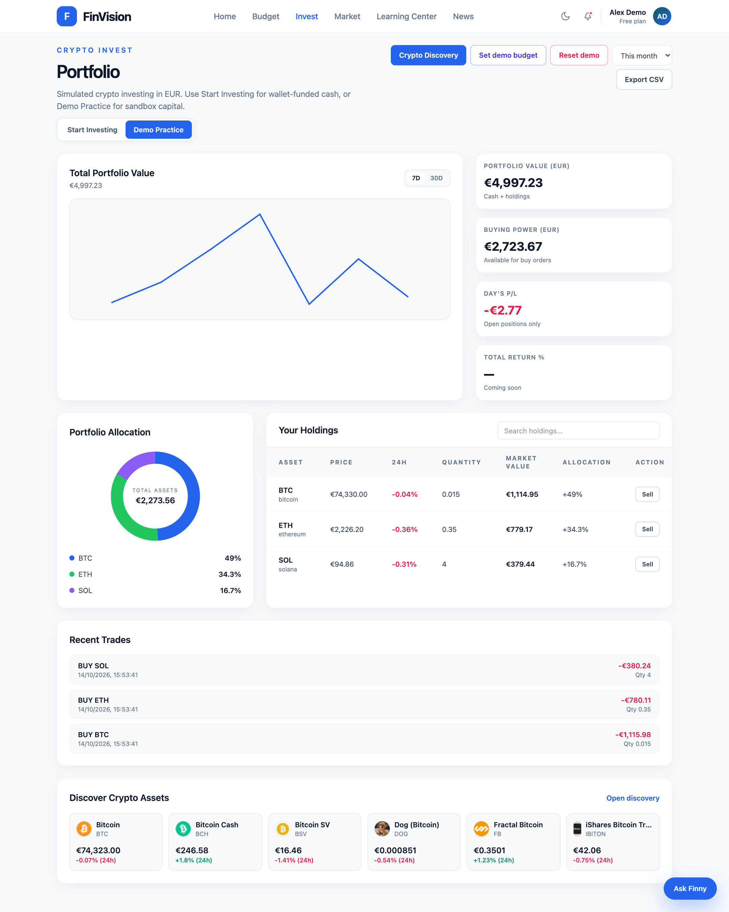
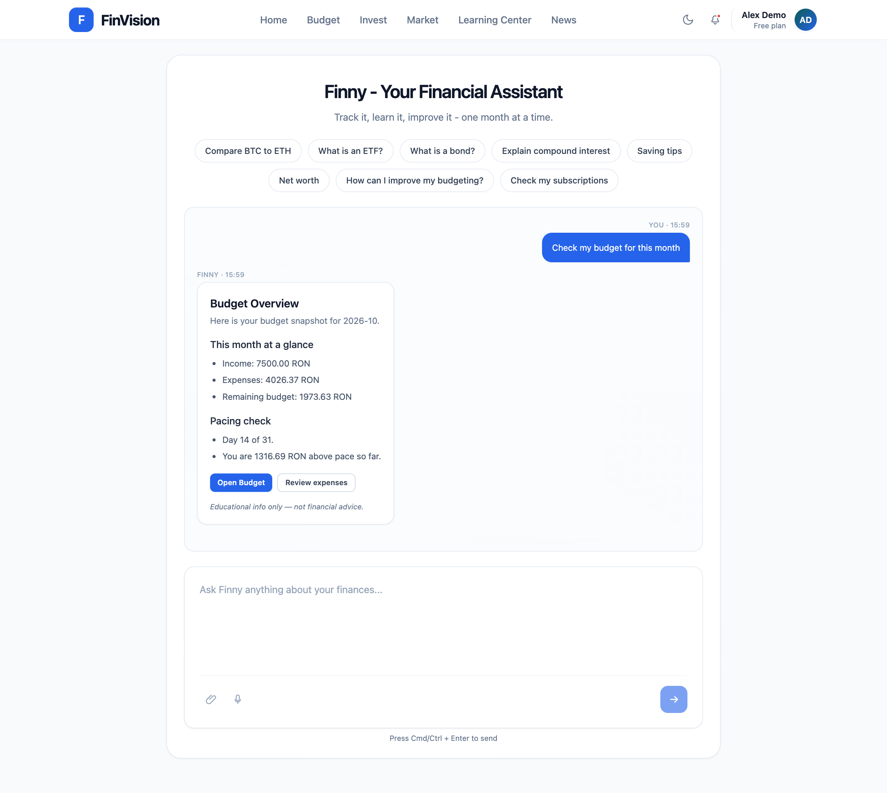
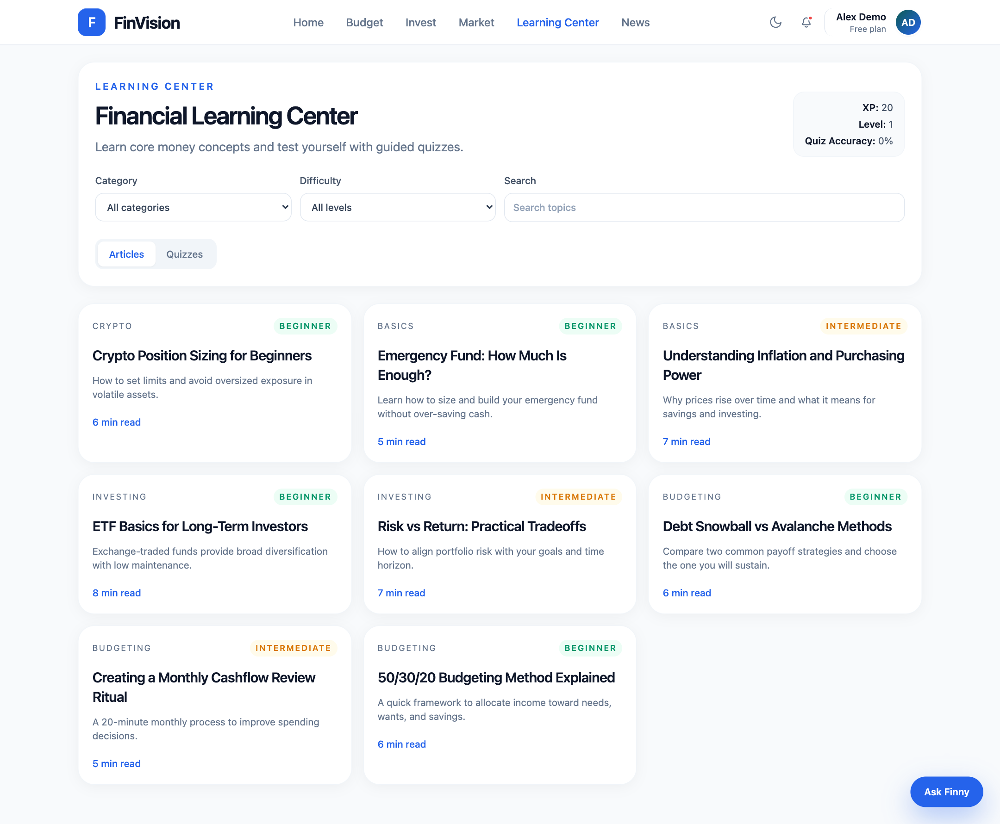
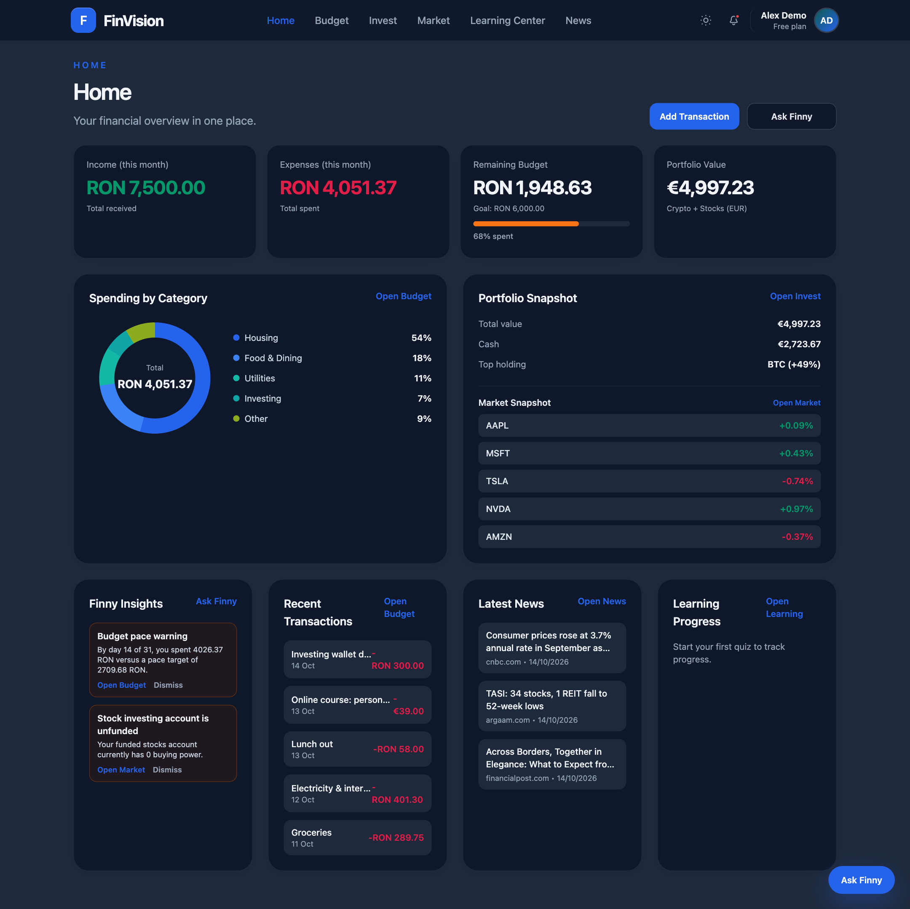

<div align="center">

# FinVision

**An integrated personal finance platform for young people: budgeting, investment simulation, financial education and an AI assistant in one place.**


</div>



---

## Table of Contents

- [The Problem](#the-problem)
- [Research Foundation](#research-foundation)
- [Features](#features)
- [Screenshots](#screenshots)
- [Tech Stack](#tech-stack)
- [Architecture](#architecture)
- [Engineering Highlights](#engineering-highlights)
- [Data Model](#data-model)
- [Project Structure](#project-structure)
- [Getting Started](#getting-started)
- [Testing](#testing)
- [Security](#security)
- [Known Limitations](#known-limitations)
- [Disclaimer](#disclaimer)
- [Academic Context](#academic-context)

---

## The Problem

Young people have no shortage of financial information. What they lack is one coherent place to act on it. Someone trying to manage their money typically juggles four disconnected tools: one for tracking expenses, one for market news, one for learning the basics and one for trying out investing. None of them talk to each other.

That fragmentation has concrete consequences: no unified view of one's finances, friction from switching between apps, and a drop-off rate that hits beginners hardest. FinVision was built to close that gap.

## Research Foundation

Rather than assuming which problems mattered most, the requirements were grounded in original research.

A cause-and-effect (Ishikawa) analysis first mapped the factors behind low financial literacy across six categories: education system, digital resources, family environment, financial market, economic context and individual behaviour. A survey of **55 respondents** (78% students, 73% aged 18–22) then quantified those factors, and the results were ranked using **Pareto analysis**.

The top seven problems accounted for roughly **75% of all high-severity mentions**:

| Rank | Problem                                    | Respondents (rated 4–5) |
| ---- | ------------------------------------------ | ----------------------- |
| 1    | No practical financial education in school | 30 (54.5%)              |
| 2    | Lack of starting capital                   | 29 (52.7%)              |
| 3    | Difficulty juggling multiple separate apps | 28 (50.9%)              |
| 4    | Cost of premium financial apps             | 28 (50.9%)              |
| 5    | Not knowing how much income to allocate    | 28 (50.9%)              |
| 6    | Fragmented financial tools                 | 25 (45.5%)              |
| 7    | No access to courses or materials          | 22 (40.0%)              |

Three of the top six relate directly to tool fragmentation, which validated the central premise of an integrated platform. **76% of respondents** (42/55) said they would use such a solution.

## Features

### Budget Management

- Income and expense tracking with system and user-defined categories, filtering and sorting
- **Recurring transactions** in five frequencies (daily, weekly, biweekly, monthly, annually) with an optional end date. Only the next occurrence is stored, instead of pre-generating every future entry.
- **Multi-currency:** transactions in RON, EUR or USD, with totals in the user's chosen base currency
- Monthly budget goal with live remaining-budget tracking, computed over UTC month boundaries
- Spending-by-category chart, plus income, balance and remaining-budget summaries
- CSV export with a UTF-8 BOM so diacritics render correctly in Excel

### Investment Simulation

Two symmetric modules, **Invest** (crypto) and **Market** (stocks), each with two modes:

- **Demo Practice:** a configurable virtual balance (default €5,000), fully detached from real finances. Can be reset at any time.
- **Start Investing:** starts at €0 and grows only from money moved out of the budget's investing wallet, tying simulated capital to real saving discipline. Cannot be reset, so funded money is never silently discarded.

Both support asset search, live pricing, buy/sell simulation and portfolio performance via daily snapshots. The Invest module also exports its trade history to CSV.

### Finny, the AI Assistant

Built on Google Gemini, available as a dedicated page and as a global widget:

- **Topic guard:** every message is screened for scope and intent before any external call. Off-topic requests get a predefined answer with zero API cost.
- **Local answers:** the most common questions (budget check, top spending categories, 30-day habit review, saving tips, net worth) are answered from the user's own data as structured cards, without calling the model.
- **Minimal context:** only the data relevant to the detected intent is sent to the model, never the user's full history.
- **No investment advice:** buy/sell recommendations are excluded by design.

### Learning Center

- Articles organized by topic, addressable by ObjectId or URL slug
- Topic quizzes with scoring, pass thresholds and a next-quiz recommendation that skips recently attempted quizzes
- XP, levels and streaks

### Financial News

- Aggregated from MarketAux, filterable by theme (budgeting, investing, crypto, macro)
- Links to original sources instead of reproducing article text

### Account & Preferences

- Partial profile updates and password change with current-password verification
- Light/dark mode and base currency (RON, EUR, USD)

## Screenshots

**Budget & Expenses**: monthly totals in the base currency, transactions in their own currency, and spending by category.



**Crypto portfolio (Demo Practice)**: portfolio value over time, allocation, holdings at live prices and recent trades.



**Finny**: a budget check answered from the user's own data as a structured card, without calling the model.



**Learning Center**: articles by topic and difficulty, with XP and level tracking.



**Dark mode**: every page has a dark theme, toggled from the header.



## Tech Stack

| Layer        | Technology                                                                                                    |
| ------------ | ------------------------------------------------------------------------------------------------------------- |
| **Frontend** | React 18, TypeScript 5, Vite 6, Tailwind CSS 3, React Router 6, Chart.js 4                                    |
| **Backend**  | Node.js 22, Express 4, Mongoose 8, Zod 3, jsonwebtoken, bcryptjs, Helmet, express-rate-limit, `@google/genai` |
| **Database** | MongoDB 7, run as a replica set (MongoDB Atlas or local Docker)                                               |
| **Testing**  | Node's built-in test runner, Supertest, mongodb-memory-server                                                 |
| **Tooling**  | npm workspaces, ESLint, Prettier                                                                              |

**External services:** CoinGecko (crypto prices) · Finnhub (stock quotes) · Stooq and Yahoo Finance (historical-price fallback) · Frankfurter (ECB exchange rates) · MarketAux (news) · Google Gemini (AI assistant)

## Architecture

FinVision is a client-server application. The React single-page app and the Node.js/Express backend run independently and communicate through a versioned REST API (`/api/v1/`).

```
┌─────────────────────┐
│   Browser           │
│   React SPA (TS)    │
└──────────┬──────────┘
           │ HTTPS, JSON
┌──────────▼──────────┐        ┌──────────────────────┐
│  API server         │◄──────►│  External APIs       │
│  Node.js + Express  │ HTTPS  │  CoinGecko, Finnhub, │
│  routes → services  │        │  MarketAux, Gemini,  │
│  → integrations     │        │  Frankfurter, Stooq  │
└──────────┬──────────┘        └──────────────────────┘
           │
┌──────────▼──────────┐
│  MongoDB replica set│
│  Mongoose ODM       │
│  16 collections     │
└─────────────────────┘
```

The backend is a **modular monolith**: one deployable service, organized into feature modules (auth, budget, transactions, categories, investing wallet, crypto, stocks, Finny, insights, education, news, profile, exports). Each module has its own routes and Zod validation schemas. Logic shared between modules, such as balance operations and currency conversion, lives in `server/src/services/`.

Every third-party API sits behind a dedicated client in `server/src/integrations/`, so the rest of the code never talks to a provider directly. When the project switched providers (GDELT → MarketAux for news, OpenAI → Gemini for the assistant), the change stayed inside the integration layer.

## Engineering Highlights

**Money operations that are safe under concurrency.** An audit found that parallel requests could spend the same balance twice: five simultaneous 1000 RON top-ups from a 1000 RON wallet all succeeded. The handlers read a balance, checked it in JavaScript, then saved a new value, so concurrent requests all passed the check. Every balance and holding change is now a single conditional atomic update in MongoDB ("subtract only if the balance is still high enough"). When several documents must change together, such as wallet, account and ledger, they run in one MongoDB transaction. Slow external calls (prices, exchange rates) happen before the transaction, never inside it. A dedicated concurrency test suite fires parallel requests at every money endpoint and asserts exact outcomes, for example that exactly 3 of 5 top-ups succeed when the wallet can afford 3.

**Refresh-token rotation and revocation.** Access tokens live 15 minutes. Each refresh token carries an ID that must match an active per-device session on the user. Refreshing replaces the session, and logging out deletes it, so a stolen or logged-out refresh token stops working. The client coalesces concurrent refreshes into one request, so rotation never signs a user out.

**Multi-currency totals without stale data.** Each transaction stores its amount in RON, EUR and USD, converted at the ECB rate for the transaction's date. Totals and net worth read the user's current base currency, so switching currency is instant and historical rates stay exact. A backfill script converts older transactions; it defaults to a dry run and writes only with `--apply`.

**Cascading provider fallback.** Historical stock prices come from Stooq first. When Stooq has no data or fails, the system falls back to Yahoo Finance, then to a single Finnhub quote. Finnhub's own historical candles return `403` on the free tier, so they are tried only when `ENABLE_FINNHUB_CANDLES_FALLBACK=true`.

**Forward-fill price resolution.** Market data has gaps (weekends, holidays, outages). Portfolio charts propagate the last known price into missing days, producing continuous lines without inventing values between real data points.

**Request coalescing.** When two identical news requests arrive before the first provider response returns, the second reuses the in-flight request instead of making a duplicate call. Together with a 10-minute cache, this keeps free-tier usage low.

**UTC-normalized date math.** Every calendar-boundary calculation builds its range explicitly in UTC, so transactions near midnight don't move between months depending on the server's timezone.

**Two-stage AI gating.** The topic guard runs before any model call, and five common intents are answered from local data, so most questions never reach Gemini.

## Data Model

16 MongoDB collections across budgeting, investing and education, modeled as UML class diagrams with a `«collection»` stereotype rather than a classic ERD, to reflect their document-oriented nature.

Relationships use **`ObjectId` references rather than embedding**. Transaction and trade documents grow without bound (embedding would risk MongoDB's 16 MB document limit), child collections are queried independently of their parent, and categories are shared across many transactions.

Every user-owned collection carries a `userId`, and queries filter on it at the data-access layer. Accessing another user's resource returns `404`, so its existence isn't revealed.

## Project Structure

```
server/
├── src/
│   ├── config/         environment schema and CORS
│   ├── database/       connection and replica-set check
│   ├── errors/         AppError and its subclasses
│   ├── integrations/   one client per external API
│   ├── middleware/     auth, validation, rate limiting, logging, errors
│   ├── models/         Mongoose schemas (16 collections)
│   ├── modules/        Finny and insights domain logic
│   ├── routes/v1/      REST endpoints, one file per feature
│   ├── services/       balance operations, orders, top-ups, currency, sessions
│   ├── utils/          shared helpers
│   └── validation/     Zod schemas per feature
├── scripts/            education seed, currency backfill
└── test/
    ├── unit/
    ├── integration/    including the concurrency suite
    └── support/        in-memory replica set runtime, API stubs

client/src/
├── components/         reusable UI, ProtectedRoute, error boundary
├── context/            auth and theme providers
├── lib/                api.ts (the typed HTTP layer), formatters, theme, currency helpers
└── pages/              one page per feature

docker-compose.yml      local MongoDB as a single-node replica set
```

## Getting Started

### Prerequisites

- **Node.js 22** (the test command uses glob patterns that need Node 21 or newer)
- **MongoDB as a replica set.** The server uses transactions and refuses to start on a standalone MongoDB. Use Docker with the included compose file, or a free MongoDB Atlas cluster.
- API keys for **Gemini**, **Finnhub**, **MarketAux** and **CoinGecko** (free demo key). Frankfurter needs no key. The app starts without them: crypto, stocks and news return `501` until their key is set, and without a Gemini key Finny still gives its local answers but replies to open questions that the assistant is unavailable.

### 1. Install

```bash
git clone https://github.com/DariusCristian/finvision-personal-finance-platform.git
cd finvision-personal-finance-platform
npm install
```

The repository uses npm workspaces, so one `npm install` at the root installs both the client and the server.

### 2. Start MongoDB

```bash
docker compose up -d mongo
```

This runs MongoDB 7 as a single-node replica set on `localhost:27017` and initializes it on first start. With Atlas, skip this step and use your Atlas connection string instead.

### 3. Configure the environment

```bash
cp server/.env.example server/.env
cp client/.env.example client/.env
```

In `server/.env`, set:

| Variable                                  | Purpose                                                                                                                  |
| ----------------------------------------- | ------------------------------------------------------------------------------------------------------------------------ |
| `MONGODB_URI`                             | Replica-set connection string. The default works with the Docker setup above.                                            |
| `JWT_ACCESS_SECRET`, `JWT_REFRESH_SECRET` | Two different random secrets of at least 32 characters. Generate each with `openssl rand -base64 48`.                    |
| `GEMINI_API_KEY`                          | Google Gemini key for Finny (read by the `@google/genai` SDK).                                                           |
| `FINNHUB_API_KEY`                         | Stock quotes.                                                                                                            |
| `MARKETAUX_API_KEY`                       | Financial news.                                                                                                          |
| `COINGECKO_API_KEY`                       | Crypto prices (free demo key).                                                                                           |
| `ENABLE_FINNHUB_CANDLES_FALLBACK`         | Optional. `true` adds Finnhub historical candles as the last fallback after Stooq and Yahoo (needs a paid Finnhub plan). |

`PORT` (default 5001), `NODE_ENV`, `CORS_ORIGINS` (default `http://localhost:5173`), rate limits and proxy settings have sensible defaults, documented in `server/.env.example`. `client/.env` only needs `VITE_API_BASE_URL`, which defaults to `http://localhost:5001`.

### 4. Seed the Learning Center (optional)

```bash
npm run seed:education --workspace finvision-server
```

### 5. Run

```bash
npm run dev
```

This starts the API on `http://localhost:5001` and the client on `http://localhost:5173`.

### Upgrading an existing database

Transactions created before multi-currency totals need their converted amounts filled in once. Run from `server/`:

```bash
npm run backfill:transaction-currencies             # dry run: reports what would change
npm run backfill:transaction-currencies -- --apply  # writes the conversions
```

The script is idempotent: already-converted transactions are skipped, so it can safely run again.

## Testing

```bash
npm test          # server test suite
npm run lint      # ESLint for client and server
```

The server suite has **117 tests** on Node's built-in test runner, with Supertest for HTTP-level assertions:

- **In-memory database.** Tests run against `mongodb-memory-server` as a single-node replica set, so transactions behave as in production. A guard refuses to start the suite against any other database.
- **No network.** Exchange rates are stubbed for every test, and prices and quotes are stubbed where tests use them; no test calls a real provider, so results are deterministic.
- **Concurrency suite.** Parallel requests against every money endpoint (top-ups, deposits, auto-fund, buys, sells, resets, first-time account creation) assert exact balances, holdings and ledger records. Every test in it failed on the code before the fix.
- **Integration and smoke tests** for auth (including token rotation and rate limits), transactions, budget totals in mixed currencies, search, insights, and the end-to-end register → login → transaction → Finny path.
- **Finny topic guard tests** check that off-topic messages are refused with no provider dependency, and that everyday finance questions are not.

## Security

- bcrypt password hashing with a cost factor of 12
- 15-minute access tokens and rotating, revocable refresh tokens (7 days)
- JWT secrets validated at startup: at least 32 characters, and placeholder values are rejected in production
- Identical errors for unknown email and wrong password, avoiding account enumeration
- Ownership enforced at query level; another user's resource returns `404`, not `403`
- Rate limiting on login (failed attempts only), register and token refresh (per IP) and on Finny chat (per user), configurable through environment variables
- Search input matched literally (escaped before reaching a regex) and length-limited
- Helmet security headers and a CORS policy limited to the configured client origins
- All third-party API keys stay on the server; none reach the frontend bundle

## Known Limitations

- **Historical stock data is incomplete.** Stooq and Yahoo don't resolve every ticker, and Finnhub's free tier has no historical candles. Affected symbols show an explicit "Chart unavailable" message instead of a broken chart.
- **Rate-limit state is in memory.** It resets when the server restarts and isn't shared across instances. A Redis or MongoDB store would fix both.
- **Recurring transactions** count in the budget summary only in the month they were created, although the transaction list shows their upcoming occurrences.
- **Monthly auto-fund** of the investing wallet is applied lazily when the wallet is read, rather than by a scheduled job. It is idempotent, so it never applies twice in a month.
- **Pending client upgrades.** React Router 7 and Tailwind CSS 4 are major upgrades that would clear the remaining client-side `npm audit` warnings. The server has no known vulnerabilities.
- **One large client bundle** (about 620 kB). Route-level code splitting would reduce the initial load.
- **No automated frontend tests.** UI flows are verified manually; end-to-end tests with Playwright are the next step.
- **English-only interface.** A language preference is stored, but the UI isn't translated yet.

## Disclaimer

FinVision is an educational project. The investment modules use virtual funds and historical or delayed market data; they are not connected to any brokerage and execute no real trades. Finny gives educational and informational answers only and is designed not to provide investment advice or buy/sell recommendations.

## Academic Context

Developed as a bachelor's thesis at **Babeș-Bolyai University**, Faculty of Economics and Business Administration (FSEGA), Economic Informatics program, Cluj-Napoca.

The thesis covers business analysis (Fishbone, Pareto, BPMN As-Is/To-Be), design (UML use case, deployment, component and class diagrams, DFD), implementation with documented algorithms in pseudocode, and testing and evaluation.

After graduation, the project was audited and hardened: concurrency-safe money operations, token revocation, rate limiting, multi-currency totals and a larger test suite.
